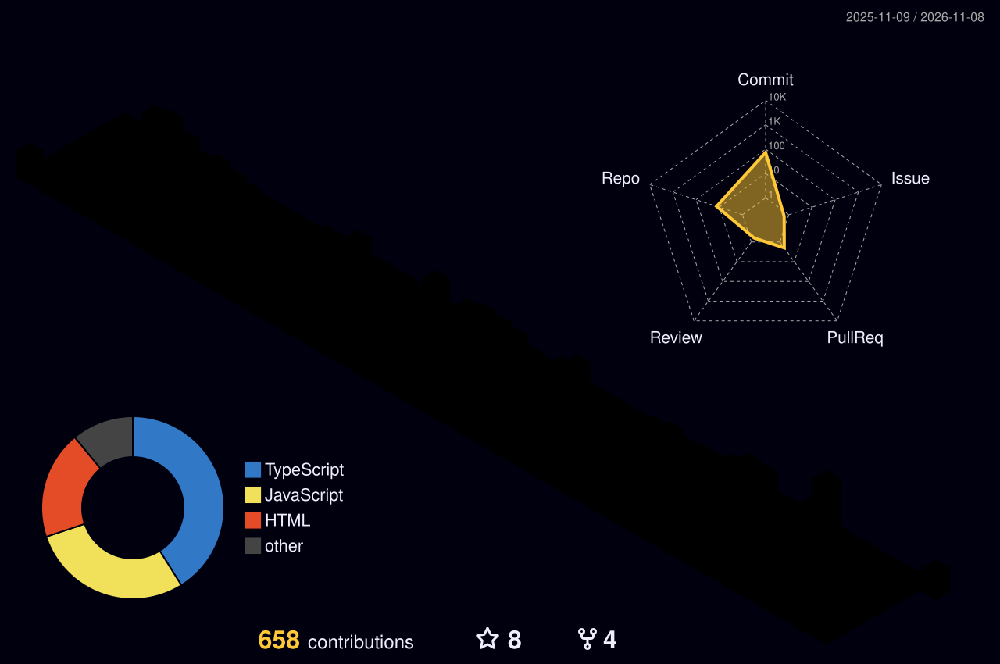

<!-- Header -->

  

  

  
  
  
  

  
  
  
  

---

### `> whoami`

I'm a **Salesforce Developer at [Inovi Solutions](https://www.inovisolutions.com)** and a full-stack engineer with a CSE background. By day I build enterprise Salesforce solutions; by night I ship developer tools and web apps that remove friction from everyday work.

<table>
  <tr>
    <td width="170">💼 <b>Role</b></td>
    <td>Salesforce Developer @ <a href="https://www.inovisolutions.com">Inovi Solutions</a></td>
  </tr>
  <tr>
    <td>📍 <b>Location</b></td>
    <td>Dhaka, Bangladesh 🇧🇩</td>
  </tr>
  <tr>
    <td>☁️ <b>Salesforce</b></td>
    <td><code>Apex</code> <code>LWC</code> <code>Aura</code> <code>SOQL/SOSL</code> <code>Flow</code> <code>REST/SOAP integrations</code></td>
  </tr>
  <tr>
    <td>🧱 <b>Full stack</b></td>
    <td><code>TypeScript</code> <code>Next.js</code> <code>React</code> <code>Node.js</code> <code>Express</code> <code>MongoDB</code> <code>MySQL</code></td>
  </tr>
  <tr>
    <td>🎯 <b>Focus</b></td>
    <td>Salesforce developer tooling · Integration architecture · System design</td>
  </tr>
  <tr>
    <td>🌱 <b>Learning</b></td>
    <td>Data science · Cloud-native (AWS / Azure)</td>
  </tr>
</table>

> ⚡ **Fun fact:** I'd rather build the tool than click the same button twice.

---

### 🧰 Tech stack

  
  
  
  

  <a href="https://skillicons.dev">
    
     
    
  </a>

---

### 🔧 Salesforce developer tooling

<table>
  <tr>
    <td width="50%" valign="top">
      <h4><a href="https://github.com/rahadulx0/sf-dev-console">⚡ SF Dev Console</a></h4>
      
A local, professional web UI on top of the Salesforce CLI. Org auth, a metadata explorer, <code>package.xml</code> generation, async Metadata API retrieval, and a schema-aware SOQL console with fuzzy autocomplete and CSV export. Tokens never reach the browser, and no database is needed.

      
      
    </td>
    <td width="50%" valign="top">
      <h4><a href="https://github.com/rahadulx0/SF-API-Names">🏷️ SF Field API Names</a></h4>
      
A Chrome extension that shows each field's API name right next to its label on Lightning record pages, like <code>Account Name [Name]</code>. Click to copy. It reads names from the DOM and falls back to object metadata, so it covers Dynamic Forms and the highlights panel too.

      
      
    </td>
  </tr>
</table>

### 🚀 Featured builds

<table>
  <tr>
    <td width="50%" valign="top">
      <h4><a href="https://github.com/rahadulx0/irbms">📊 IRBMS: Resource &amp; Billing</a></h4>
      
An internal SaaS for a software agency. It tracks hours per project, monitors utilization, prevents over- and under-billing, auto-generates and emails PDF invoices, and keeps a full audit trail.

      <b>Next.js 14 · Express · MySQL · JWT + RBAC · PDFKit</b>
    </td>
    <td width="50%" valign="top">
      <h4><a href="https://github.com/rahadulx0/WC2026">⚽ World Cup 2026 Live Center</a></h4>
      
Live scores, fixtures, standings, the knockout bracket, squads and a stats dashboard. A caching Express proxy feeds an auto-refreshing Next.js frontend, with no database.

      <b>Next.js 15 · React 19 · Tailwind v4 · SWR · Express</b> 
      
    </td>
  </tr>
  <tr>
    <td width="50%" valign="top">
      <h4><a href="https://github.com/rahadulx0/Dispatch">📰 Dispatch: News CMS</a></h4>
      
A production-grade blogging platform with a classic newspaper UI: a live ticker, a trending strip, category landings, and a full rich-text editor.

      <b>Next.js 14 · TypeScript · Express · MongoDB</b> 
      
    </td>
    <td width="50%" valign="top">
      <h4><a href="https://github.com/rahadulx0/devcard">🪪 GitID: Developer ID Cards</a></h4>
      
Turns any GitHub profile into a shareable visual ID card with stats, a language breakdown, top topics, and a featured repo.

      <b>HTML · CSS · JavaScript · GitHub API</b> 
      
    </td>
  </tr>
</table>

<b>More projects</b>

 

| Project | What it is | Links |
|---|---|---|
| **Mermaide** | Mermaid.js diagram editor with Monaco, resizable panes, and dark/light themes | [code](https://github.com/rahadulx0/Mermaide) |
| **Password Manager** | React + Express vault with OTP auth, encryption, and a password generator | [code](https://github.com/rahadulx0/Password-Manager) |
| **Lead Qualification SaaS** | B2B lead scoring and routing platform on Supabase/PostgreSQL | [code](https://github.com/rahadulx0/lead-qualification-saas) |
| **Markdown Preview** | Live Markdown editor and previewer | [code](https://github.com/rahadulx0/Markdown-Preview) · [demo](https://md-prev-eta.vercel.app) |
| **README Viewer** | Preview any GitHub README beautifully | [code](https://github.com/rahadulx0/GitHub-Readme-Viewer) · [demo](https://readmee-coral.vercel.app) |
| **Hotel Management System** | Booking and guest management app | [code](https://github.com/rahadulx0/Hotel-Management-System) |
| **Papier Factory** | MERN stack e-commerce project | [code](https://github.com/rahadulx0/Papier-Factory-MERN-Stack-Project) |
| **Problem solving** | LeetCode, online-judge and contest solutions | [LeetCode](https://github.com/rahadulx0/Leetcode-Solutions) · [OJ](https://github.com/rahadulx0/Online-Judge-Solves) · [contests](https://github.com/rahadulx0/contest-solves) |

---

### 📈 GitHub activity

  <picture>
    <source media="(prefers-color-scheme: dark)" srcset="./profile-3d-contrib/profile-night-rainbow.svg" />
    <source media="(prefers-color-scheme: light)" srcset="./profile-3d-contrib/profile-gitblock.svg" />
    
  </picture>

  <picture>
    <source media="(prefers-color-scheme: dark)" srcset="https://streak-stats.demolab.com/?user=rahadulx0&theme=github-dark-blue&hide_border=true&background=0D1117&ring=00A1E0&fire=6E40C9&currStreakLabel=00A1E0" />
    <source media="(prefers-color-scheme: light)" srcset="https://streak-stats.demolab.com/?user=rahadulx0&theme=default&hide_border=true&ring=00A1E0&fire=6E40C9&currStreakLabel=00A1E0" />
    
  </picture>

  <picture>
    <source media="(prefers-color-scheme: dark)" srcset="./assets/github-snake-dark.svg" />
    <source media="(prefers-color-scheme: light)" srcset="./assets/github-snake.svg" />
    
  </picture>

---

### 🤝 Let's build something

I'm always up for interesting Salesforce problems, developer-tooling ideas, and full-stack collaborations. The fastest way to reach me is [email](mailto:mr.if449@gmail.com) or [LinkedIn](https://linkedin.com/in/rahadulx0).

> *"Code with purpose, build with passion, learn without limits."*

  

