<a href="https://rahadul.vercel.app">
  <picture>
    <source media="(prefers-color-scheme: dark)" srcset="./assets/hero-dark.svg" />
    <source media="(prefers-color-scheme: light)" srcset="./assets/hero-light.svg" />
    
  </picture>
</a>

  
  
  
  
  

<!-- 01 · whoami -->
<picture>
  <source media="(prefers-color-scheme: dark)" srcset="./assets/h-whoami-dark.svg" />
  <source media="(prefers-color-scheme: light)" srcset="./assets/h-whoami-light.svg" />
  
</picture>

<picture>
  <source media="(prefers-color-scheme: dark)" srcset="./assets/neofetch-dark.svg" />
  <source media="(prefers-color-scheme: light)" srcset="./assets/neofetch-light.svg" />
  
</picture>

> [!TIP]
> By day I build enterprise Salesforce solutions at **[Inovi Solutions](https://www.inovisolutions.com)**. By night I ship developer tools that remove friction from everyday work, because I'd rather build the tool than click the same button twice.

<!-- 02 · toolbox -->
<picture>
  <source media="(prefers-color-scheme: dark)" srcset="./assets/h-stack-dark.svg" />
  <source media="(prefers-color-scheme: light)" srcset="./assets/h-stack-light.svg" />
  
</picture>

  
  
  
  

  <a href="https://skillicons.dev">
    
     
    
  </a>

<!-- 03 · salesforce tooling -->
<picture>
  <source media="(prefers-color-scheme: dark)" srcset="./assets/h-tooling-dark.svg" />
  <source media="(prefers-color-scheme: light)" srcset="./assets/h-tooling-light.svg" />
  
</picture>

  <a href="https://github.com/rahadulx0/sf-dev-console"><picture>
    <source media="(prefers-color-scheme: dark)" srcset="./assets/card-sf-dev-console-dark.svg" />
    <source media="(prefers-color-scheme: light)" srcset="./assets/card-sf-dev-console-light.svg" />
    
  </picture></a>
  <a href="https://github.com/rahadulx0/SF-API-Names"><picture>
    <source media="(prefers-color-scheme: dark)" srcset="./assets/card-sf-api-names-dark.svg" />
    <source media="(prefers-color-scheme: light)" srcset="./assets/card-sf-api-names-light.svg" />
    
  </picture></a>

<!-- 04 · featured builds -->
<picture>
  <source media="(prefers-color-scheme: dark)" srcset="./assets/h-builds-dark.svg" />
  <source media="(prefers-color-scheme: light)" srcset="./assets/h-builds-light.svg" />
  
</picture>

  <a href="https://github.com/rahadulx0/irbms"><picture>
    <source media="(prefers-color-scheme: dark)" srcset="./assets/card-irbms-dark.svg" />
    <source media="(prefers-color-scheme: light)" srcset="./assets/card-irbms-light.svg" />
    
  </picture></a>
  <a href="https://wc-2026-tan.vercel.app"><picture>
    <source media="(prefers-color-scheme: dark)" srcset="./assets/card-wc2026-dark.svg" />
    <source media="(prefers-color-scheme: light)" srcset="./assets/card-wc2026-light.svg" />
    
  </picture></a>
  <a href="https://dispatch-five-lime.vercel.app"><picture>
    <source media="(prefers-color-scheme: dark)" srcset="./assets/card-dispatch-dark.svg" />
    <source media="(prefers-color-scheme: light)" srcset="./assets/card-dispatch-light.svg" />
    
  </picture></a>
  <a href="https://gitid.vercel.app"><picture>
    <source media="(prefers-color-scheme: dark)" srcset="./assets/card-gitid-dark.svg" />
    <source media="(prefers-color-scheme: light)" srcset="./assets/card-gitid-light.svg" />
    
  </picture></a>

  <b>LIVE</b> cards open the demo · source: <a href="https://github.com/rahadulx0/WC2026">WC2026</a> · <a href="https://github.com/rahadulx0/Dispatch">Dispatch</a> · <a href="https://github.com/rahadulx0/devcard">GitID</a>

<b>📂 More projects</b>

 

| Project | What it is | Links |
|---|---|---|
| **Mermaide** | Mermaid.js diagram editor with Monaco, resizable panes, and dark/light themes | [code](https://github.com/rahadulx0/Mermaide) |
| **Password Manager** | React + Express vault with OTP auth, encryption, and a password generator | [code](https://github.com/rahadulx0/Password-Manager) |
| **Lead Qualification SaaS** | B2B lead scoring and routing platform on Supabase/PostgreSQL | [code](https://github.com/rahadulx0/lead-qualification-saas) |
| **Markdown Preview** | Live Markdown editor and previewer | [code](https://github.com/rahadulx0/Markdown-Preview) · [demo](https://md-prev-eta.vercel.app) |
| **README Viewer** | Preview any GitHub README beautifully | [code](https://github.com/rahadulx0/GitHub-Readme-Viewer) · [demo](https://readmee-coral.vercel.app) |
| **Hotel Management System** | Booking and guest management app | [code](https://github.com/rahadulx0/Hotel-Management-System) |
| **Papier Factory** | MERN stack e-commerce project | [code](https://github.com/rahadulx0/Papier-Factory-MERN-Stack-Project) |
| **Problem solving** | LeetCode, online-judge and contest solutions | [LeetCode](https://github.com/rahadulx0/Leetcode-Solutions) · [OJ](https://github.com/rahadulx0/Online-Judge-Solves) · [contests](https://github.com/rahadulx0/contest-solves) |

<!-- 05 · activity -->
<picture>
  <source media="(prefers-color-scheme: dark)" srcset="./assets/h-activity-dark.svg" />
  <source media="(prefers-color-scheme: light)" srcset="./assets/h-activity-light.svg" />
  
</picture>

  <picture>
    <source media="(prefers-color-scheme: dark)" srcset="./profile-3d-contrib/profile-night-rainbow.svg" />
    <source media="(prefers-color-scheme: light)" srcset="./profile-3d-contrib/profile-gitblock.svg" />
    
  </picture>

  <picture>
    <source media="(prefers-color-scheme: dark)" srcset="https://streak-stats.demolab.com/?user=rahadulx0&theme=github-dark-blue&hide_border=true&background=00000000&ring=00A1E0&fire=8957E5&currStreakLabel=00A1E0" />
    <source media="(prefers-color-scheme: light)" srcset="https://streak-stats.demolab.com/?user=rahadulx0&theme=default&hide_border=true&background=00000000&ring=0176D3&fire=6639BA&currStreakLabel=0176D3" />
    
  </picture>

  <picture>
    <source media="(prefers-color-scheme: dark)" srcset="./assets/github-snake-dark.svg" />
    <source media="(prefers-color-scheme: light)" srcset="./assets/github-snake.svg" />
    
  </picture>

<!-- 06 · connect -->
<picture>
  <source media="(prefers-color-scheme: dark)" srcset="./assets/h-connect-dark.svg" />
  <source media="(prefers-color-scheme: light)" srcset="./assets/h-connect-light.svg" />
  
</picture>

  I'm always up for interesting Salesforce problems, developer-tooling ideas, and full-stack collaborations. 
  The fastest way to reach me is <a href="mailto:mr.if449@gmail.com">email</a> or <a href="https://linkedin.com/in/rahadulx0">LinkedIn</a>.

<picture>
  <source media="(prefers-color-scheme: dark)" srcset="./assets/footer-dark.svg" />
  <source media="(prefers-color-scheme: light)" srcset="./assets/footer-light.svg" />
  
</picture>
